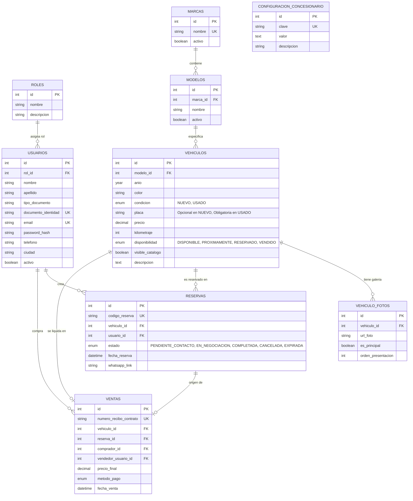

# Documentación del Proyecto: Concesionario Digital (JDS Vehículos)

Este documento detalla la arquitectura de base de datos, el flujo de negocio, el modelo relacional y las especificaciones funcionales para el sistema de concesionario digital.

---

## 1. Alcance y Reglas de Negocio

### 1.1 Catálogo y Vehículos
- **Condición**: 
  - `NUEVO`: No requiere placa (puede no estar matriculado aún). Kilometraje en 0.
  - `USADO`: Obligatoriamente debe registrar su **placa** y kilometraje actual.
- **Disponibilidad de Inventario**:
  - `DISPONIBLE`: En stock físico y listo para ser reservado o comprado.
  - `PROXIMAMENTE`: En tránsito o por ingresar al inventario (visible con etiqueta de preventa/próxima llegada).
  - `RESERVADO`: Un cliente ha apartado el vehículo y se encuentra en proceso de atención.
  - `VENDIDO`: El concesionario cerró la venta. Se oculta del catálogo activo (`visible_catalogo = FALSE`).
- **Galería Multimedia**: Cada vehículo soporta múltiples fotografías (`vehiculo_fotos`), permitiendo marcar una imagen como principal/portada y ordenarlas.

### 1.2 Usuarios y Autenticación
- Los clientes deben registrarse e iniciar sesión para reservar un vehículo.
- **Datos básicos del comprador**:
  - Nombres y Apellidos.
  - Tipo y número de documento de identidad (Cédula de Ciudadanía, Extranjería, NIT, etc.).
  - Teléfono celular (clave para el contacto vía WhatsApp).
  - Correo electrónico y contraseña cifrada (`password_hash`).
  - Dirección y ciudad de residencia.

### 1.3 Flujo de Reserva y Contacto por WhatsApp
1. **Exploración**: El usuario consulta el catálogo filtrando por marca, modelo, precio, año, color o condición (Nuevo/Usado).
2. **Selección**: El usuario ingresa al detalle del vehículo.
3. **Autenticación obligatoria**: Al hacer clic en *"Reservar este vehículo"*, si no está logueado, el sistema redirige al Login o Registro.
4. **Reserva**:
   - Se crea un registro en la tabla `reservas` asociando el `usuario_id` con el `vehiculo_id`.
   - El estado del auto en `vehiculos` cambia a `RESERVADO`.
   - Se genera un código único de reserva (ej: `RES-2026-X892`).
5. **Redirección a WhatsApp**:
   - La aplicación genera un enlace dinámico con el API de WhatsApp:
     ```text
     https://wa.me/573202353168?text=Hola%20JDS%20Vehículos,%20he%20reservado%20el%20auto%20{Marca}%20{Modelo}%20(Código:%20{codigo_reserva}).%20Mi%20nombre%20es%20{Nombre}%20y%20deseo%20continuar%20con%20el%20proceso.
     ```
   - El usuario abre la conversación directamente con el asesor comercial.

### 1.4 Cierre de Negocio y Salida de Stock
- La negociación física, financiera o de traspaso ocurre **fuera de la plataforma**.
- El personal del concesionario (rol `ADMIN` o `ASESOR`):
  1. Marca la reserva como `COMPLETADA` (o `CANCELADA` si no prosperó).
  2. Registra la venta en la tabla `ventas` vinculando el vehículo, el comprador y el valor final pactado.
  3. El vehículo pasa automáticamente a disponibilidad `VENDIDO` y `visible_catalogo = FALSE`.
  4. Si una reserva se cancela o expira, el auto retorna a estado `DISPONIBLE`.

---

## 2. Diagrama Entidad-Relación (ERD)



---

## 3. Diccionario de Datos

| Tabla | Propósito |
| :--- | :--- |
| `roles` | Perfiles de usuario: `CLIENTE`, `ADMIN`, `ASESOR`. |
| `usuarios` | Datos de clientes compradores y administradores del concesionario. |
| `marcas` | Fabricantes automotrices (Toyota, Mazda, Chevrolet, etc.). |
| `modelos` | Líneas asociadas a cada marca (Corolla, CX-30, Onix, etc.). |
| `vehiculos` | Catálogo de autos con especificaciones técnicas, precio, color, placas y disponibilidad. |
| `vehiculo_fotos` | Enlaces a imágenes alojadas con soporte para foto de portada (`es_principal`). |
| `reservas` | Apartado temporal del auto por el cliente y generación del link de WhatsApp. |
| `ventas` | Registro histórico del cierre de la transacción económica fuera de la app. |
| `configuracion_concesionario` | Parámetros del negocio como el número oficial de WhatsApp y plantillas de mensaje. |

---

## 4. Gestión de Base de Datos y Migraciones con Prisma

> [!NOTE]
> El archivo [`docs/legacy/database.sql`](legacy/database.sql) se conserva únicamente como referencia histórica del diseño inicial. En el proyecto real, el esquema se modela y evoluciona a través de **Prisma ORM** y migraciones versionadas.

### 1. Iniciar el servicio de base de datos MySQL (Docker)
El proyecto incluye un contenedor MySQL 8 configurado con charset `utf8mb4` y collation `utf8mb4_unicode_ci`:
```bash
pnpm db:up
```

### 2. Ejecutar las migraciones
Para sincronizar el esquema y aplicar las migraciones versionadas en la base de datos local:
```bash
pnpm db:migrate
```

### 3. Comandos útiles de base de datos
- `pnpm db:up`: Inicia el contenedor MySQL en segundo plano.
- `pnpm db:down`: Detiene el contenedor MySQL.
- `pnpm db:migrate`: Aplica las migraciones pendientes en desarrollo.
- `pnpm db:generate`: Genera el cliente de Prisma (`@prisma/client`).
- `pnpm db:reset`: Restablece la base de datos recreándola desde cero y ejecutando todas las migraciones.
- `pnpm db:studio`: Abre la interfaz visual de Prisma Studio en el navegador.
